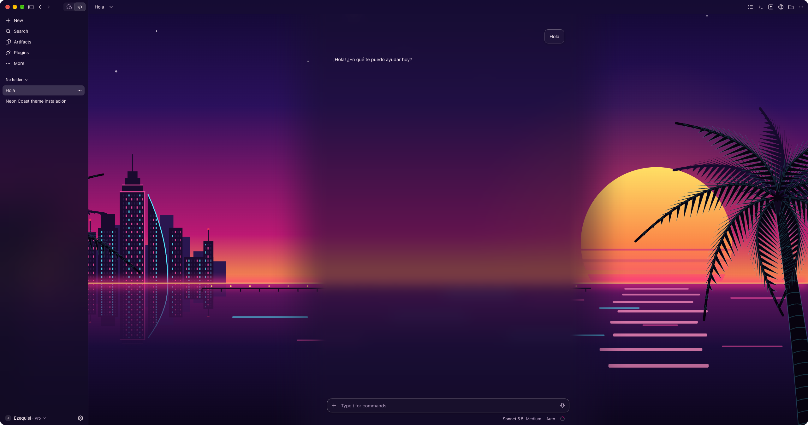

# Neon Coast

A neon tropical sunset theme for the Claude app, with a GTA VI vibe but with its own artwork.



## What it includes

- **A complete palette** for light and dark mode: violet grays, magenta for actions, and cyan as a counterpoint in code.
- **An animated background** behind the conversation: an Art Deco skyline with its reflection in the water, a lit causeway crossing the bay, a striped sun, swaying palm trees and gusts of wind that sweep from left to right. On mobile the background has its own vertical composition.

Light mode is a peach and turquoise dawn with golden details. Dark mode is an indigo night with pink and cyan neon.

## Requirements

- The Claude desktop app (or the mobile one), up to date. The theme is drawn there. It does not show up in the terminal or in editors.
- A recent Claude Code. The theme is a mod: a plugin with a hooks module that uses the Claude Code mods API, which is in early access and may change between versions.
- Nothing else to install: the theme is four text files.

## Install

The full guide, with the complete source of every file, is in [neon-coast-theme.en.md](neon-coast-theme.en.md).

The quickest way is to open a Claude Code session, attach that file and write:

> Install the theme from this file: create the folder `~/claude-themes/neon-coast` with its files and activate it with method A.

Then open a new session. To do it by hand, follow the steps in the guide: create the folder and the four files, then run:

```bash
claude plugin marketplace add ~/claude-themes/neon-coast
claude plugin install neon-coast@neon-coast
```

## Troubleshooting

If the animated background does not show, check the accessibility options of your system, such as Reduce motion. With that option on, the app shows a still scene or none at all. Open a new session after changing it.

## Customizing

Everything lives in `hooks/register.tsx`: the position and size of the sun, city, palms and causeway, the shape of the buildings, the sky and sea colors, the speed of the wind and the UI palette. The guide has a table of what to change and where.

To turn it off, run `claude plugin uninstall neon-coast` and open a new session.
